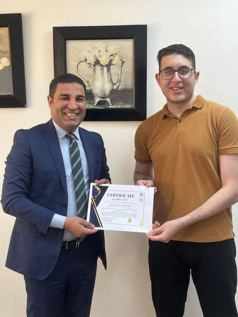
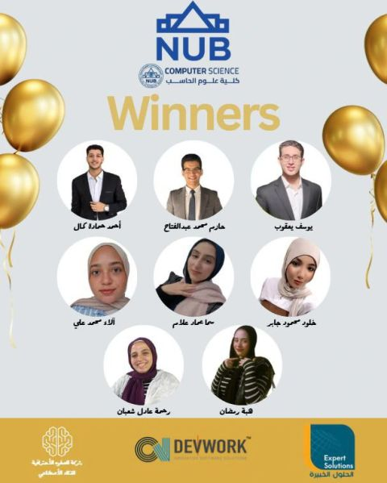

# TechMind Challenge 2025

Three environmental monitoring projects in one repository. Each folder is a full copy of its original project, including that project's own README and setup steps.

## Winners

These projects won the NUB Computer Science competition.





| Challenge | Folder | Focus |
| --- | --- | --- |
| 1 | [Challenge-1-Red-Sea-Coral-Reef-Guardian](Challenge-1-Red-Sea-Coral-Reef-Guardian) | Classify coral health from images and review reef trends in a web app |
| 2 | [Challenge-2-Desert-Agriculture-Sentinel](Challenge-2-Desert-Agriculture-Sentinel) | Monitor desert crops from satellite data and plan irrigation |
| 3 | [Challenge-3-Sand-Dune-Encroachment-Tracker](Challenge-3-Sand-Dune-Encroachment-Tracker) | Forecast sand dune movement and flag risk to land and infrastructure |

## Run a project

Open the folder for the challenge you want, then follow its README.

```bash
cd Challenge-1-Red-Sea-Coral-Reef-Guardian
python -m venv venv
venv\Scripts\activate
pip install -r requirements.txt
python app.py
```

```bash
cd Challenge-2-Desert-Agriculture-Sentinel
python -m venv venv
venv\Scripts\activate
pip install -r requirements.txt
python main.py
```

```bash
cd Challenge-3-Sand-Dune-Encroachment-Tracker
python -m venv venv
venv\Scripts\activate
pip install -r requirements.txt
```

Challenge 3's dashboard is the static page at `Challenge-3-Sand-Dune-Encroachment-Tracker/web/index.html`.

## Sources

- https://github.com/Youssef123ya/Challenge-1-Red-Sea-Coral-Reef-Guardian
- https://github.com/Youssef123ya/Challenge-2-Desert-Agriculture-Sentinel
- https://github.com/Youssef123ya/Challenge-3-Sand-Dune-Encroachment-Tracker
